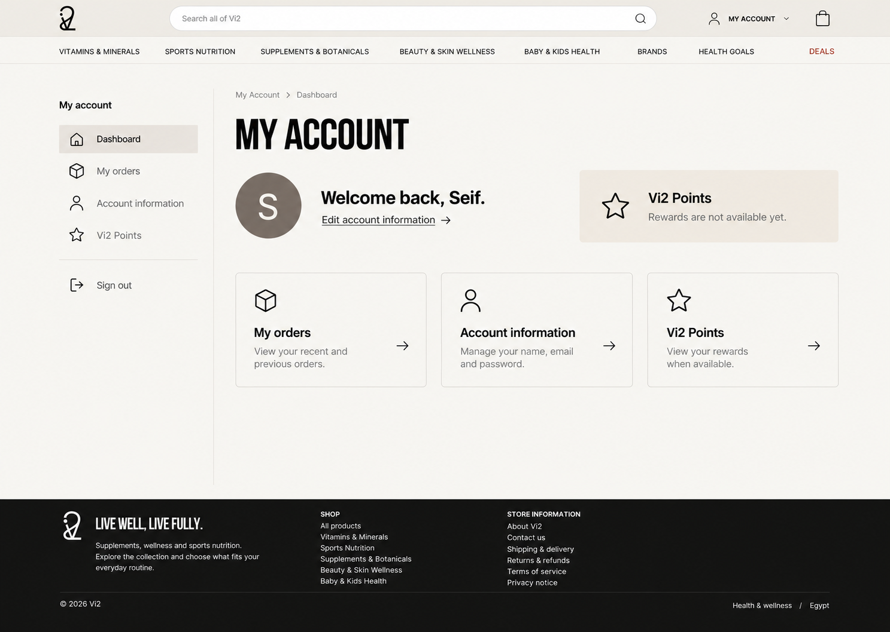
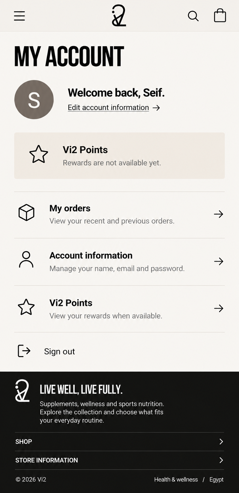

# Account page — frontend/backend handoff

2026-10-20. Seif approved the iHerb-informed revision-3 dashboard and requested frontend implementation on branch `account-page`. GPT's worktree is `C:/Users/Seif Waleed/.codex/worktrees/account-page/vi2`, starting at local full-stack `5c4cbd9`. This includes newer reviewed cart/email/storage/image work; do not silently use an older backend snapshot for acceptance.

## Approved designs

Desktop: [approved-desktop.png](design/account-page/approved-desktop.png)

Mobile: [approved-mobile.png](design/account-page/approved-mobile.png)

The desktop comp is a spatial reference: existing site header/footer, narrow persistent account sidebar, main heading and identity, independent points summary, then three task destinations. Mobile uses the existing compact header and stacked account navigation rows. Match the current Vi2 fonts/tokens from source, including Inter/Bebas Neue/Cairo and Ink/Paper/Cream/Stone; image-rendering approximations do not authorize a new font or color. User rejected the earlier nested forms/order receipts/dashboard-within-dashboard arrangement.

## Route and navigation contract (frontend-owned)

All routes retain /en or /ar and URL language/RTL. No new backend endpoint is implied by these page paths.

| Page | Route | Content |
|---|---|---|
| Dashboard | /[locale]/account | Identity, unavailable-points summary, three clear task destinations |
| Account Information | /[locale]/account/information | Name, email, phone if known, password action and current language; label/value/edit rows with focused editing states |
| My Orders | /[locale]/account/orders | Real customer-owned recent orders; honest loading, empty, error/retry and order-detail presentation |
| Vi2 Points | /[locale]/account/points | Explicit unavailable state until a confirmed loyalty contract exists |

Existing dropdown: remove Buy It Again and My Favorites. My Account and View Account point to information; My Orders to orders; My Rewards to points. Preserve existing user icon, guest CTA, auth/session and sign-out behavior. Audit equivalent desktop/mobile account links and legacy account fragments so they reach the same meaningful sections.

## Ownership: avoid parallel editing conflicts

GPT owns apps/storefront account page/components/styles, account-specific interface copy and affected navigation links/tests. No edits to apps/backend, auth provider/BFF routes, secrets, schema, shared package/lock/config files or native commerce rules.

Claude owns backend implementation on a separate branch/folder once Seif dispatches it. Do not edit GPT's account-page worktree or frontend-owned files. Agree and document any future BFF/service changes before integration; do not have both agents change the same file. Shared package/lock/AGENTS/decision changes still need Seif's approval.

## What already exists (inspect the installed version, do not rebuild it)

- Medusa 2.21 customer/auth/order primitives. Storefront `Customer` shape: id, email, firstName, lastName, optional phone/hasAccount.
- CustomerProvider/useAuth reads `/api/auth/me` through HttpOnly-cookie BFF -> native `/store/customers/me`. It exposes refreshCustomer, sign-in/out and isLoading. Reuse this verified identity; never accept an arbitrary customer ID as ownership.
- `services.orderService.getCustomerOrders(limit=20)` reads `/api/orders`, BFF forwards the signed-in token to native `/store/orders`. Current BFF supports limit (1-100) only and returns orders without total/count/offset. Existing native Order model has reference/id/date/status/paymentStatus/currency/items/totals. Do not invent delivery status from order status or pretend a partial list is complete history.
- A working `changePassword(currentPassword,newPassword)` service and `/api/auth/password` already exist. Preserve its verification/session/rate-limit behavior. Frontend may restyle/localize the existing form without replacing backend behavior. Password reset/sign-in/registration stay functional.
- Guest `getOrder(orderId)` is a confirmation capability, not a replacement for authenticated customer-owned order detail authorization.

## Backend work for Claude to assess and propose

1. Native account updates: allowlisted first/last name and optional phone. Return the authoritative updated customer; agree on validation/error codes and how the current provider refreshes. No speculative new custom module if native customer update is sufficient.
2. Email change: customer email and login identity must stay consistent. Inspect installed Medusa behavior; explicitly define re-authentication, uniqueness, verification, retry/failure/session behavior. Do not treat changing only a display field as changing credentials or invent an OTP/verification service. Existing password flow is already implemented.
3. Orders: verify native authenticated ownership and stable order/date/status/item/totals contract; support real limit/offset/count only if exposed and agreed. Confirm detail endpoint authorization and missing/foreign ID behavior. No tracking/Bosta promises or provider work.
4. Loyalty: Seif requested an area and backend parallel work, but earning rates, redemption conversion/minimums, expiry, refund reversals, guest eligibility, migration and authoritative balance owner are NOT defined. Keep unavailable; ask Seif for those business decisions before building a ledger or showing an invented zero/balance/tier. UI needs explicit unavailable/loading/error/available states once contracted; do not silently substitute a cache or browser balance.
5. Negative checks: unauthenticated/expired and cross-customer access, unsupported fields, invalid/duplicate email, wrong current password, failed update without partial identity corruption, repeated request, native order paging boundaries, logout/session continuity. No real email/payment/provider calls in isolated tests.

This is a requirements handoff, not a pre-agreed API specification. Claude should document the exact native/backend response contracts and unresolved decisions before GPT wires new writes or loyalty.

## Frontend-only behavior in this delivery

Use real existing customer/order reads and preserve the existing password-change operation. Build name/email/phone edit layout and local validation/cancel states; new uncontracted save operations remain clearly unavailable, with no fake saved-success, localStorage customer/points authority or guessed endpoints. No sample customer, sample orders or illustrative balances shipped as live facts. Guests get a clear sign-in state; session restoration must not flash stale identity. Order-list rows remain scoped to the authenticated customer; unsupported search/filters/pagination are not advertised.

All new navigation/account text is keyed EN/AR, outside legacy DOM replacement. Readable current 16px body/14px UI roles, 44px actions, visible focus, inline errors, sensible focus return, long-name/RTL/bidi wrapping and mobile navigation remain acceptance requirements.

## Review and integration

GPT runs meaningful frontend regressions, type/lint/build and EN/AR desktop/mobile checks, then gives Seif a small Claude review prompt. Backend work and frontend review are separate responsibilities. No backend changes, automatic merge, push or deployment in this UI task. Owner merges only after review and agreed integration acceptance.
